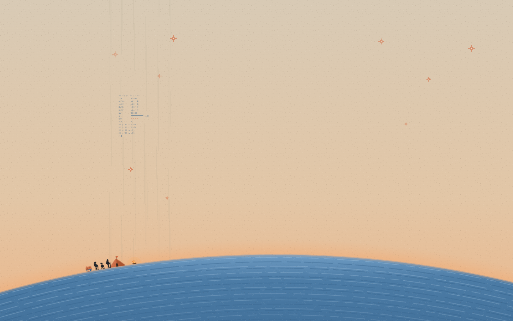
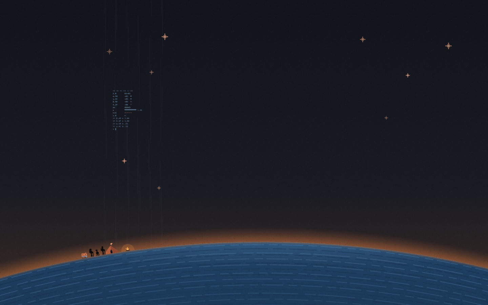
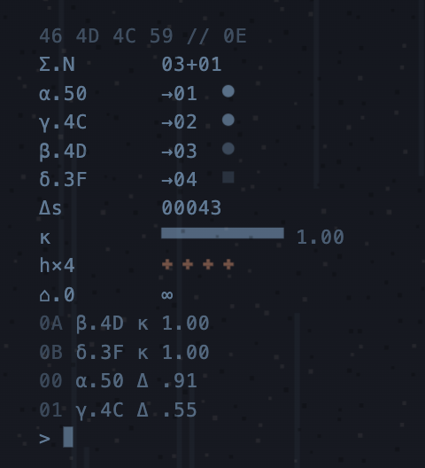

<div align="center">

# Far Horizon

**A film-trailer theme for the Claude desktop app.**

A dusty peach sky, a curved steel-blue planet horizon, and a small family of hikers walking its edge.



[Features](#features) · [Screenshots](#screenshots) · [Installation](#installation) ·
[Customization](#customization) · [Development](#development)

</div>

## Features

- **Animated horizon.** A dusty beige-to-peach sky over a curved steel-blue planet, its ripples
  drifting like slow water, with a soft peach glow along the rim.
- **A walking family.** A man, a woman and a little girl, with a small terracotta pixel pet, walk
  across the horizon past a pixel campsite with a crackling fire, each on their own stride.
- **Small pixel touches.** Sparks breathe softly in the sky, faint streaks fall, and a fine grain
  sits over the whole scene.
- **A family log.** A small column of readings for each walker, with a feed below that scrolls by a
  line at a time.
- **Light and dark.** Each mode has its own palette, and the app's interface colors (surfaces, text,
  accents) are derived from the same palette so they match the scene.
- **Frosted glass.** The app's panels blur the scene lightly, so the sky and horizon glow through.
- **Respects reduce motion.** All animation stops when the system's "reduce motion" setting is on.
- **Lightweight.** A single SVG of about 40 KB, animated with CSS only: no scripts, no images, no
  SVG filters.

## Screenshots

The backdrop on its own, as it sits behind the app's frosted panels. These are still frames; in the
app everything moves.

| Light | Dark |
| :---: | :---: |
|  |  |

**The family.** The pet, the woman, the girl and the man walk the horizon at their own pace, past
the tent and the campfire. The ripples underfoot drift like slow water.


**The family log.** Fixed readings for each walker, with a feed below that pushes up a line at a
time.



## Requirements

- The **Claude desktop app** (Code tab) or the **Claude mobile app**. The terminal and the editor
  extensions don't draw themes.
- Read access to this GitHub repository, and a git credential for github.com on your machine (an SSH
  key, or `gh auth login` followed by `gh auth setup-git`). The repository is private, so it installs
  only for people who have been invited to it.

## Installation

### From a shell

```bash
claude plugin install theme-example --marketplace zyn1018/far-horizon-theme
```

### From a Claude Code terminal session

```
/plugin install theme-example --marketplace zyn1018/far-horizon-theme
```

Answer `y` to add the marketplace, then pick a scope. **User scope** applies the theme to every
session.

### From the desktop app

`/plugin` does not run in the desktop app. Instead:

1. Click **+** next to the prompt box, then **Plugins**.
2. **Add marketplace** with `zyn1018/far-horizon-theme`.
3. **Add plugin** and pick `theme-example`.

The theme applies when a session starts; there is nothing to switch on.

## Updating

Each change to the theme bumps its patch version. With auto-update turned on for the marketplace,
Claude Code picks up the new version at startup. To update by hand:

```bash
claude plugin marketplace update far-horizon-theme
```

```bash
claude plugin update theme-example
```

## Uninstalling

```bash
claude plugin uninstall theme-example
```

To keep it installed but turn it off for now, use `claude plugin disable theme-example`.

## Customization

Everything lives in two files under `hooks/`.

| What | Where |
| --- | --- |
| Interface colors (surfaces, text, accent, danger, success, warning) for each mode | `ARGS` in `hooks/register.tsx` |
| Frosted-glass blur and opacity of the app's panels | `LOOK.backdrop.glass` in `hooks/register.tsx` |
| Scene colors for each mode (sky, land, ripples, figures, campfire) | the CSS variables at the top of `horizonScene()` in `hooks/scene.ts` |
| Ripple count, how many drift, and their speed | `RIPPLE` in `hooks/scene.ts` |
| How long the family takes to cross the window | `WALK_SECONDS` in `hooks/scene.ts` |
| Each walker's stride and spacing | `STEP` and `GAPS` in `hooks/scene.ts` |
| Rows, lines in view and push speed of the scrolling feed | `FEED` in `hooks/scene.ts` |

`hooks/make-colors.js` is generated from the design system's theme code; don't edit it.

## How it works

The theme is a Claude Code plugin with one hooks module, `hooks/register.tsx`:

- On `session.start` it calls `$.theme.set()` with the interface colors and a backdrop: the scene
  `far-horizon` with a frosted-glass setting for the panels. If a color can't be painted, it says so
  in a toast.
- On `ui.render` for the `Backdrop` component it draws the scene, an SVG built once by
  `horizonScene()` in `hooks/scene.ts`, on the desktop and mobile surfaces.

The scene is plain SVG with CSS animation. It follows a few rules, so it scales cleanly and stays
smooth under the frosted glass:

- The root uses `viewBox="0 0 1600 1000"` with `preserveAspectRatio="xMidYMid slice"`.
- No scripts, SVG filters or blend modes.
- Figures are placed with SVG attributes, and only relative offsets are animated.
- Anything that changes on every frame without a transform, such as the drifting ripples, sits in its
  own `will-change: transform` group, so the rest of the land isn't redrawn with it.

## Project structure

```
.
├── .claude-plugin/
│   ├── marketplace.json   # this repository is its own marketplace
│   └── plugin.json        # plugin name, version and description
├── hooks/
│   ├── hooks.json         # names the hooks module
│   ├── register.tsx       # theme colors, glass and the Backdrop hook
│   ├── scene.ts           # builds the animated SVG scene
│   ├── make-colors.js     # generated: derives the full palette from a few colors
│   └── make-colors.d.ts
├── screenshots/           # images used in this README
└── tsconfig.json
```

## Development

1. Clone the repository and open a Claude Code session in it.
2. Load it as a hot-reloading plugin, so each edit redraws the app when the turn ends:

   ```bash
   claude --plugin-dir .
   ```

3. Check it:

   ```bash
   claude plugin validate .
   ```

   Claude Code writes the API types to `.claude-plugin/types/` once the plugin has loaded. After
   that, type-check with:

   ```bash
   tsc -p .
   ```

To preview the scene outside the app, write the output of `horizonScene()` into an HTML page and
open it in a Chromium-based browser. The app draws the scene in a sandboxed frame, so it looks and
moves the same.

When you change the version yourself, bump `version` in `.claude-plugin/plugin.json`, or installed
copies won't see the update.
